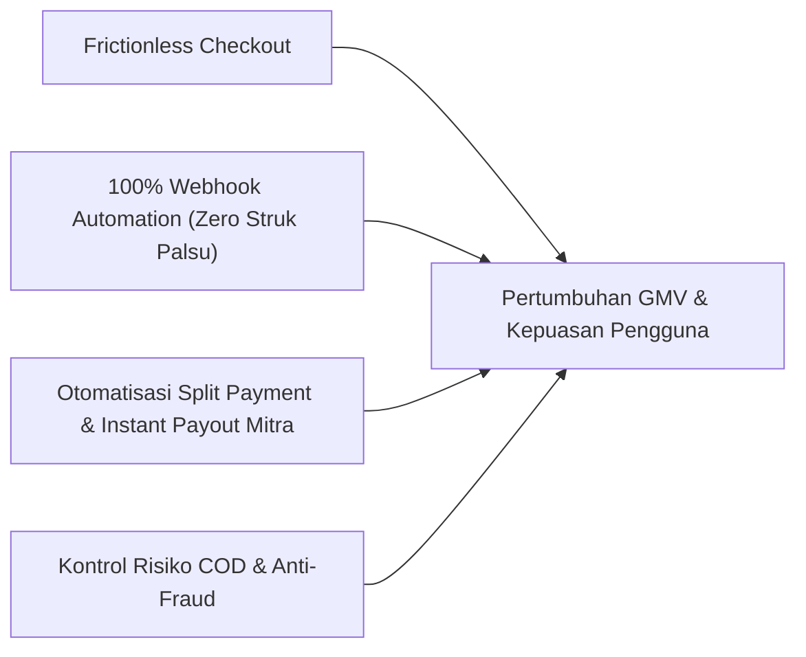
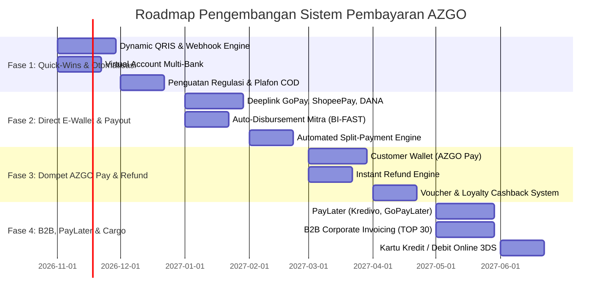
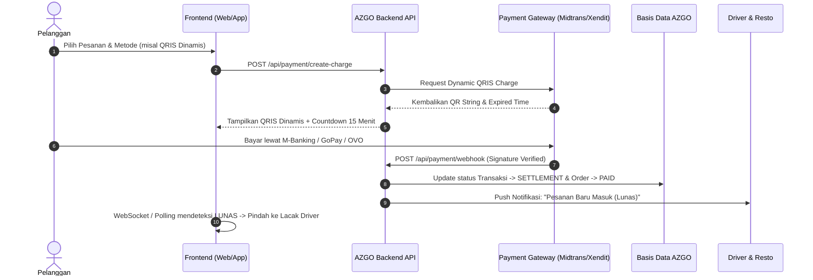

# Rencana Pengembangan Komprehensif Sistem Pembayaran AZGO
**Nusantara Delivery & Logistics SuperApp**

---

## 1. Eksekutif Ringkasan & Kondisi Saat Ini (Current State Analysis)

AZGO mengintegrasikan berbagai pilar logistik nasional:
* **AZ Delivery & Food:** Pengiriman instan dan makanan/minuman resto.
* **AZ Courier:** Ekspedisi paket reguler dengan model Hub-and-Spoke (Drop Point, Sorting Center, Hub Gateway, AWB Waybill).
* **AZ Cargo:** Pengiriman barang berat/armada logistik (pickup, blind van, engkel, fuso).
* **AZ Mart:** Belanja kebutuhan sembako & harian.
* **AZ Ride:** Ojek motor dan taksi online.
* **AZ Pickup:** Layanan penjemputan barang ekspedisi ke lokasi pengirim.

### Kondisi Sistem Pembayaran Saat Ini:
1. **QRIS Masih Manual / Statis:**
   * Admin mengunggah gambar barcode statis dan nomor NMID.
   * Pelanggan harus memindai gambar, memasukkan nominal sendiri, lalu **mengunggah screenshot struk pembayaran**.
   * *Kelemahan:* Rawan struk palsu/editan (fraud), proses verifikasi manual lambat, menghambat otomatisasi penugasan driver.
2. **Tunai / Cash on Delivery (COD):**
   * Pelanggan membayar uang tunai ke kurir saat barang tiba dengan simulasi nominal uang pas/pecahan Rp 50.000 / Rp 100.000.
   * *Kelemahan:* Risiko pembeli fiktif atau menolak bayar saat barang sampai (Return to Origin - RTO), dan rekonsiliasi setoran uang tunai driver ke platform masih belum terkontrol otomatis.
3. **Dompet Saldo Mitra (Driver & Merchant Wallet):**
   * Sudah memiliki pencatatan komisi (15% driver, 15% resto/mart, 12% cargo) dan tabel permintaan penarikan saldo (*WithdrawalRequest*).
   * *Kelemahan:* Proses pencairan dana (payout) masih mengandalkan persetujuan admin dan transfer manual via m-banking.
4. **Ketiadaan Dompet Pelanggan (Customer Wallet):**
   * Belum ada saldo in-app untuk pelanggan sehingga setiap pemesanan harus melalui checkout manual, dan pembatalan order (refund) belum memiliki kanal otomatis.

---

## 2. Tujuan Strategis Pengembangan (Key Objectives)



1. **Otomatisasi Verifikasi 100% (Instant Payment Confirmation):** Menghilangkan upload struk manual dengan menghubungkan sistem ke Payment Gateway via Webhook real-time.
2. **Fleksibilitas Metode Pembayaran:** Menyediakan QRIS Dinamis, Virtual Account Bank (BCA, Mandiri, BRI, BNI), E-Wallet (GoPay, OVO, DANA, ShopeePay), dan PayLater.
3. **Automated Escrow & Split Payment:** Uang pembayaran pesanan otomatis terbagi secara presisi detik itu juga: ongkir ke saldo driver, harga produk ke merchant, komisi ke kas platform AZGO.
4. **Auto-Disbursement Mitra 24/7:** Mitra driver dan toko dapat mencairkan saldo kapan saja secara instan melalui integrasi transfer bank otomatis (API Payouts/Iris).
5. **Mitigasi Risiko COD:** Penerapan limit transaksi COD, validasi nomor handphone (OTP), dan batasan saldo minus kurir.

---

## 3. Matriks Evaluasi & Pemilihan Payment Gateway

Untuk pasar Indonesia, terdapat beberapa agregator pembayaran resmi terdaftar di Bank Indonesia (PJP Kategori 3):

| Fitur / Parameter | Midtrans (GoTo Financial) | Xendit | DOKU | Tripay |
| :--- | :--- | :--- | :--- | :--- |
| **Dynamic QRIS** | Sangat Stabil (NMID Nasional) | Sangat Stabil | Stabil | Cepat & Murah |
| **Virtual Account** | BCA, Mandiri, BNI, BRI, Permata, Danamon, CIMB | BCA, Mandiri, BNI, BRI, Permata, Sahabat Sampoerna | Lengkap | Lengkap |
| **E-Wallet Direct** | GoPay, ShopeePay (Deeplink Native) | OVO, DANA, ShopeePay, LinkAja | Lengkap | DANA, OVO, ShopeePay |
| **API Payouts / Disbursement** | Midtrans Iris (Sangat cepat, 24/7 BI-FAST) | Xendit XenPlatform / Disburse | DOKU Payout | Terbatas |
| **Split Payment Otomatis** | Mendukung via Sub-Account | Mendukung via XenPlatform | Custom agreement | Manual |
| **Struktur Biaya MDR** | QRIS 0.7%, VA Rp 2.000-4.000, E-Wallet 1.5-2.0% | Mirip Midtrans, negosiasi volume | Mirip | Fleksibel untuk UMKM |
| **Rekomendasi AZGO** | **Pilihan Utama (Primer)** | **Pilihan Sekunder (Alternatif Kuat)** | Pelengkap | Alternatif Awal |

> [!TIP]
> **Rekomendasi Arsitektur:** Gunakan **Midtrans** atau **Xendit** dengan pola desain *Adapter Pattern*. Dengan arsitektur terisolasi, AZGO dapat beralih atau membagi beban (*failover*) ke gateway cadangan tanpa merombak logika aplikasi.

---

## 4. Roadmap Pengembangan Bertahap (4 Fase)



### 🔹 Fase 1: Otomatisasi Verifikasi & Multi-Bank (Bulan 1 - 2)
* **Dynamic QRIS (QRIS Dinamis Otomatis):**
  * Barcode QR digenerate secara unik per order (sudah tertanam nominal rupiah eksak).
  * Dilengkapi countdown timer 15 menit.
  * Ketika pelanggan membayar lewat aplikasi bank/e-wallet mana pun, Webhook PG langsung menembak backend AZGO -> Status pesanan otomatis berubah jadi `PAID` dalam hitungan detik. Hapus kebutuhan upload bukti gambar.
* **Virtual Account (VA) Bank Terkemuka:**
  * Penyediaan nomor rekening VA otomatis (BCA, Mandiri, BRI, BNI).
  * Ideal untuk transaksi bernilai sedang hingga tinggi (AZ Courier antarkota dan AZ Cargo).
* **Standarisasi & Pengamanan COD (Cash on Delivery):**
  * Penerapan limit nominal maksimal COD (misal maks. Rp 300.000 untuk makanan/ojek; barang kargo besar tidak diizinkan COD tanpa uang muka).
  * Validasi nomor telepon pelanggan via OTP SMS/WhatsApp saat pertama kali order COD.
  * *Driver Cash Collection Reconciliation:* Sistem membatasi saldo minus kurir (jika driver menampung uang tunai COD melebihi batas Rp 500.000, akun driver dihentikan sementara hingga melakukan setoran).

### 🔹 Fase 2: Direct E-Wallet & Otomatisasi Payout Mitra (Bulan 3 - 4) — *Fokus Prioritas*
* **Direct E-Wallet Deeplink:**
  * Pengguna mobile yang memilih GoPay, DANA, ShopeePay, atau OVO akan langsung dialihkan (*deeplink*) ke aplikasi e-wallet terkait untuk konfirmasi 1-ketukan, lalu otomatis kembali ke AZGO.
* **Otomatisasi Disbursement Saldo Mitra Dual-Mode (Xendit Payout / Midtrans Iris via BI-FAST):**
  Mitra logistik memiliki dinamika arus kas harian yang berbeda-beda. Oleh karena itu, sistem pencairan dana dirancang dengan **dua mode terintegrasi**:
  1. **Mode A: Pencairan Otomatis Terjadwal (Scheduled Auto-Disbursement):**
     * Sistem melakukan auto-transfer batch secara terjadwal (misal: otomatis setiap hari pukul 23:00 WIB atau setiap hari Senin pagi).
     * Saldo mitra yang melewati ambang batas minimal (misal > Rp 50.000) otomatis ditransfer ke rekening bank / e-wallet terdaftar tanpa perlu pengajuan manual.
     * Bebas biaya admin transfer (disubsidi oleh platform sebagai benefit loyalitas kemitraan).
  2. **Mode B: Permohonan Penarikan Instan Sewaktu-waktu (On-Demand Instant Withdrawal 24/7):**
     * Mitra **tidak wajib menunggu jadwal rutin** jika mendesak membutuhkan uang tunai (misal: kurir butuh beli bensin/makan siang/uang darurat, atau resto butuh modal belanja bahan subuh).
     * Fitur di aplikasi: Tombol *"Tarik Saldo Sekarang"*. Mitra memasukkan nominal yang diinginkan, konfirmasi dengan PIN Keamanan, dan dana langsung dikirim detik itu juga melalui API Payouts BI-FAST (masuk dalam 10-60 detik, 24/7 termasuk hari libur).
     * *Kebijakan Penarikan Instan:* Diberikan kuota 1x gratis per hari (atau pembebanan biaya flat switching bank Rp 2.000 - Rp 2.500 per tarikan instan tambahan), minimal tarikan Rp 20.000, serta menjaga sisa saldo minimal (misal Rp 10.000) agar kurir tetap aktif menerima pesanan.
     * *Auto-Approval vs Flagging:* Penarikan instan nominal wajar (misal < Rp 1.500.000) disetujui otomatis oleh sistem; penarikan nominal sangat besar atau perubahan rekening baru dalam 24 jam memerlukan verifikasi OTP SMS/WhatsApp demi keamanan dari pembajakan akun.
* **Realtime Split-Payment Engine:**
  * Begitu pesanan dinyatakan `COMPLETED` oleh driver dan customer:
    $$\text{Total Bayar} = \text{Harga Barang} + \text{Ongkos Kirim} + \text{Biaya Aplikasi}$$
    $$\text{Saldo Masuk Driver} = \text{Ongkos Kirim} - (15\% \times \text{Ongkos Kirim})$$
    $$\text{Saldo Masuk Merchant} = \text{Harga Barang} - (15\% \times \text{Harga Barang})$$
    $$\text{Pendapatan Kas AZGO} = \text{Komisi Driver} + \text{Komisi Merchant} + \text{Biaya Aplikasi}$$
  * Perhitungan ini langsung dikreditkan ke masing-masing saldo akun mitra secara instan.

### 🔹 Fase 3: AZGO Pay (Dompet Internal Pelanggan) & Instant Refund (Bulan 5 - 6)
* **AZGO Pay (Customer In-App Wallet):**
  * Pelanggan dapat melakukan *Top Up* saldo menggunakan QRIS atau Virtual Account.
  * Checkout tercepat: Bayar dengan saldo AZGO Pay hanya butuh verifikasi PIN / Sidik Jari (biometrik).
* **Instant Refund Engine:**
  * Jika driver membatalkan order atau makanan di resto habis, dana langsung dikembalikan 100% ke saldo AZGO Pay saat itu juga (mengeliminasi komplain pelanggan).
* **Voucher Promo & Diskon Terintegrasi:**
  * Potongan promo langsung disubsidi dari pos pemasaran platform pada saat settlement.

### 🔹 Fase 4: PayLater & Ekosistem Korporat B2B (Bulan 7+)
* **Integrasi PayLater (Kredivo, Akulaku, GoPayLater):**
  * Membuka akses cicilan 30 hari hingga 12 bulan untuk pesanan logistik bernilai besar (seperti sewa armada truk AZ Cargo, pindahan rumah, pengiriman logistik antar-pulau).
* **B2B Corporate Invoicing (Term of Payment - TOP 14/30 Hari):**
  * Khusus klien bisnis ekspedisi atau pabrik yang melakukan pengiriman rutin harian dengan sistem tagihan bulanan (invoice konsolidasian).
* **Kartu Kredit & Debit Online (Visa / Mastercard / JCB):**
  * Terproteksi protokol 3D-Secure (OTP Bank penerbit kartu) dan tokenisasi PCI-DSS.

---

## 5. Arsitektur Teknis & Skema Database

### A. Kontrak Data Tambahan di `@delivery/shared`
```typescript
// packages/shared/src/types/payment.ts

export type PaymentMethodType = 
  | 'CASH'
  | 'AZGO_PAY'
  | 'QRIS_DYNAMIC'
  | 'VIRTUAL_ACCOUNT'
  | 'EWALLET_GOPAY'
  | 'EWALLET_SHOPEEPAY'
  | 'EWALLET_DANA'
  | 'EWALLET_OVO'
  | 'PAYLATER'
  | 'CREDIT_CARD';

export type PaymentChannelBank = 'BCA' | 'MANDIRI' | 'BRI' | 'BNI' | 'PERMATA' | 'CIMB';

export type PaymentTransactionStatus = 
  | 'PENDING'
  | 'SETTLEMENT'
  | 'DENIED'
  | 'EXPIRED'
  | 'CANCELLED'
  | 'REFUNDED';

export interface PaymentTransaction {
  id: string;
  orderId: string;
  orderNumber: string;
  customerId: string;
  amount: number;
  paymentMethod: PaymentMethodType;
  channel?: PaymentChannelBank | string;
  externalTransactionId?: string; // ID dari Midtrans/Xendit
  qrCodeUrl?: string;
  qrString?: string;
  vaNumber?: string;
  deeplinkUrl?: string;
  status: PaymentTransactionStatus;
  expiresAt: string;
  paidAt?: string;
  rawGatewayResponse?: any;
  createdAt: string;
  updatedAt: string;
}
```

### B. Alur Webhook Otomatisasi (Sequence Diagram)


---

## 6. Model Biaya MDR (Merchant Discount Rate) & Strategi Monetisasi

| Metode Pembayaran | Estimasi Biaya Payment Gateway | Strategi Pembebanan AZGO |
| :--- | :--- | :--- |
| **QRIS Dinamis** | 0.7% (Regulasi Bank Indonesia) | Subsidi platform dari `appFee` (Rp 2.000) agar pelanggan bebas biaya admin. |
| **Virtual Account** | Flat Rp 2.000 - Rp 3.500 per transaksi | Gratis untuk transaksi > Rp 100.000; untuk transaksi kecil dapat digabung ke `Biaya Jasa Aplikasi`. |
| **E-Wallet (GoPay/DANA)** | 1.5% - 2.0% dari nominal | Ditanggung dari margin platform atau subsidi promosi kemitraan. |
| **Disbursement Payout** | Flat Rp 1.500 - Rp 2.500 per transfer | Biaya pencairan Rp 2.500 dibebankan ke mitra saat klik Tarik Saldo (standar industri). |
| **COD (Tunai)** | 0% biaya bank | Ditambah biaya asuransi COD jika bernilai di atas Rp 200.000. |

---

## 7. Rencana Mitigasi Risiko & Keamanan (Risk & Fraud Mitigation)

1. **Keamanan Webhook:**
   * Setiap request webhook dari payment gateway wajib diverifikasi keasliannya menggunakan *HMAC SHA512 Signature Key*.
   * Menggunakan konsep **Idempotency Key** agar jika payment gateway mengirimkan notifikasi ganda, saldo tidak terhitung dua kali.
2. **Mitigasi Race Condition Saldo Dompet:**
   * Menggunakan database atomic transactions (`SELECT ... FOR UPDATE` pada PostgreSQL) saat pemotongan saldo dompet agar saldo tidak bisa terpotong minus jika dipencet berulang kali secara paralel.
3. **Pemberantasan Fake Order COD:**
   * Fitur batasan alamat jika nomor handphone memiliki riwayat penolakan COD (RTO) sebanyak 2 kali berturut-turut, metode COD otomatis dimatikan bagi akun tersebut.
4. **Audit Log & Reconcile Otomatis:**
   * Sistem *Cron Job* malam hari (pukul 23:59) untuk membandingkan total transaksi di database AZGO dengan mutasi settlement di dashboard Payment Gateway (Zero Discrepancy).
